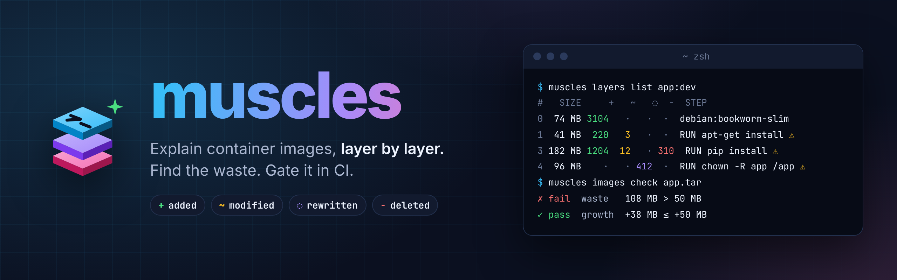
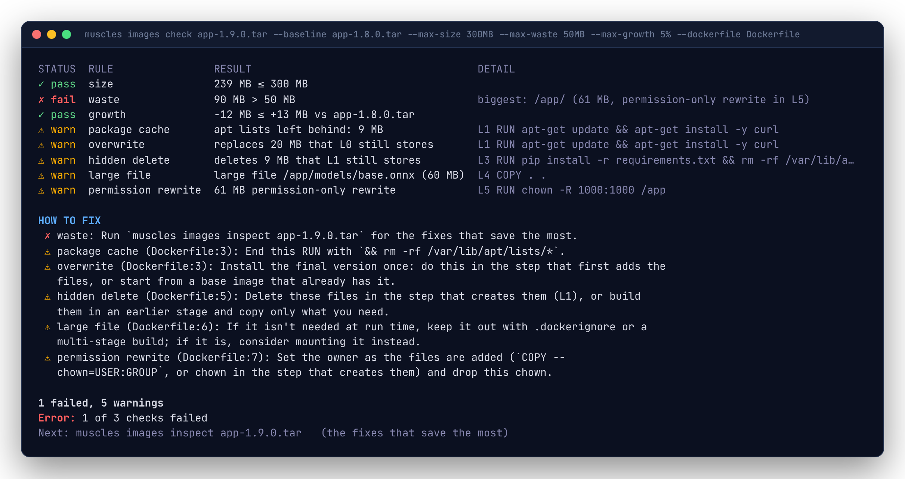

<p align="center">
  
</p>

<p align="center">
  <a href="https://github.com/rossedman/muscles/actions/workflows/ci.yml"></a>
  <a href="https://github.com/rossedman/muscles/actions/workflows/pages.yml"></a>
  <a href="LICENSE"></a>
  
  
</p>

muscles explains container images. For every layer it shows what was **added**, **modified**, **rewritten** with the same contents and **deleted**, next to the Dockerfile step that did it. It finds **waste** (bytes an image stores but never shows), compares two images file by file, and fails a CI build when an image breaks its budgets.

It reads images from the local Docker daemon, a registry (without pulling), a `docker save` tarball or an OCI layout, and runs the same on a laptop and in CI.

**Docs: [rossedman.io/muscles](https://rossedman.io/muscles/)**

<p align="center">
  
</p>

- **Every layer, explained.** Sizes, change counts and the Dockerfile step for each layer, with notes for package caches left behind, deletions that free nothing, `chown -R` rewrites and large files.
- **Waste, attributed.** Every hidden byte with the layer that stored it and the layer that hid it, and how to fix each kind.
- **Release diffs.** Which layers two images share, how each one that differs changed, and every path that changed.
- **CI budgets.** Size, compressed size, waste, growth against the main branch, layer count and forbidden paths (`**/.env`), from a committed `.muscles.yaml`. Exit 5 on failure, GitHub annotations, Markdown for the job summary.
- **Fast.** Each layer is read once and its index cached by digest, so a base image is read once for every image built on it. Registry images are streamed, never pulled.
- **Made for scripts too.** It follows [CLI Style](https://cli.style): data on stdout, `--json` on every command, plain tab-separated lines when piped, documented exit codes, and `help --json` for agents.

## Install

With Homebrew, on macOS or Linux:

```sh
brew install rossedman/tap/muscles
```

With Go 1.26 or later:

```sh
go install github.com/rossedman/muscles/cmd/muscles@latest
```

As a container, for CI: `ghcr.io/rossedman/muscles`. Or download an archive from the [releases page](https://github.com/rossedman/muscles/releases); archives include shell completions and a man page.

It's a single static binary. Docker is optional.

## Quick start

```sh
muscles python:3.12-slim                            # what to fix first, and what it saves
muscles layers list python:3.12-slim                # what each layer did
muscles changes list python:3.12-slim --layer 2     # the files one layer changed
muscles waste list python:3.12-slim                 # bytes stored but never seen
muscles images diff ghcr.io/acme/app:1.8.0 ghcr.io/acme/app:1.9.0
muscles images check app.tar --baseline ghcr.io/acme/app:main
```

<p align="center">
  
</p>

## Commands

| Command | What it does |
|---|---|
| `muscles IMAGE` | Short for `muscles images inspect IMAGE`: size, waste, and the fixes ranked by what they save |
| `muscles layers list IMAGE` | Each layer: size, `+ ~ ◌ -` counts, Dockerfile step, the packages it installed or a warning |
| `muscles changes list IMAGE` | The paths layers changed: `--layer`, `--type`, `--path`, `--min-size`, `--files` |
| `muscles waste list IMAGE` | Hidden bytes, biggest first, with the layers that stored and hid them |
| `muscles images diff BASE TARGET` | One-sentence verdict, shared layers, package changes, and the filesystem diff |
| `muscles images check IMAGE` | Budgets and forbidden paths, each with how to fix it; `--baseline` for growth; exits 5 on failure |
| `muscles config list` | Every setting, its value and where it came from |
| `muscles cache list` / `cache delete` | The layer index cache (`--preview` to look first) |
| `muscles help [COMMAND] [--json]` | Full help, or the command tree as JSON |
| `muscles version [--json]` | Version, commit and platform |

Every command takes `-o table|plain|json|markdown` (or `--json`), and `--dockerfile Dockerfile` to point layers and fixes at their lines. `muscles layers IMAGE` is short for `muscles layers list IMAGE` (and the same for `changes` and `waste`). See the [CLI reference](https://rossedman.io/muscles/cli/).

`IMAGE` is a daemon tag (`app:dev`), a registry reference (`ghcr.io/acme/app:main`), a tarball (`app.tar`) or an OCI layout (`./out`, `oci://./out:tag`).

## In CI

Commit budgets next to your Dockerfile:

```yaml
# .muscles.yaml
check:
  max_size: 800MB
  max_waste: 50MB      # or "10%"
  max_growth: 5%       # vs --baseline
  forbid: ["**/.env", "**/.git/", "**/*.pem"]
```

Then, in GitHub Actions, after building the image to a tarball:

```yaml
- run: go install github.com/rossedman/muscles/cmd/muscles@latest
- run: muscles images diff ghcr.io/acme/app:main app.tar -o markdown >> "$GITHUB_STEP_SUMMARY"
- run: muscles images check app.tar --baseline ghcr.io/acme/app:main
```

<p align="center">
  
</p>

The full workflow, other CI systems and caching are in the [CI guide](https://rossedman.io/muscles/ci/).

## Exit codes

`0` ok · `1` error · `2` usage · `3` auth · `4` not found · `5` check failed · `130` interrupted

## How it works

<p align="center">
  
</p>

Each layer's tar is streamed once and indexed (paths, sizes, modes, owners and a content hash, never the contents). The layers are then replayed over a merged filesystem, following the OCI whiteout rules, to classify every path and attribute every hidden byte to the layer that stored it and the layer that hid it. See [How it works](https://rossedman.io/muscles/how-it-works/) and [Design](https://rossedman.io/muscles/design/).

## Contributing

Issues and pull requests are welcome. See [CONTRIBUTING.md](CONTRIBUTING.md); `make check`, `make cover` (90% or more) and `make lint` are what CI runs. For security issues, see [SECURITY.md](SECURITY.md).

## License

[MIT](LICENSE)
