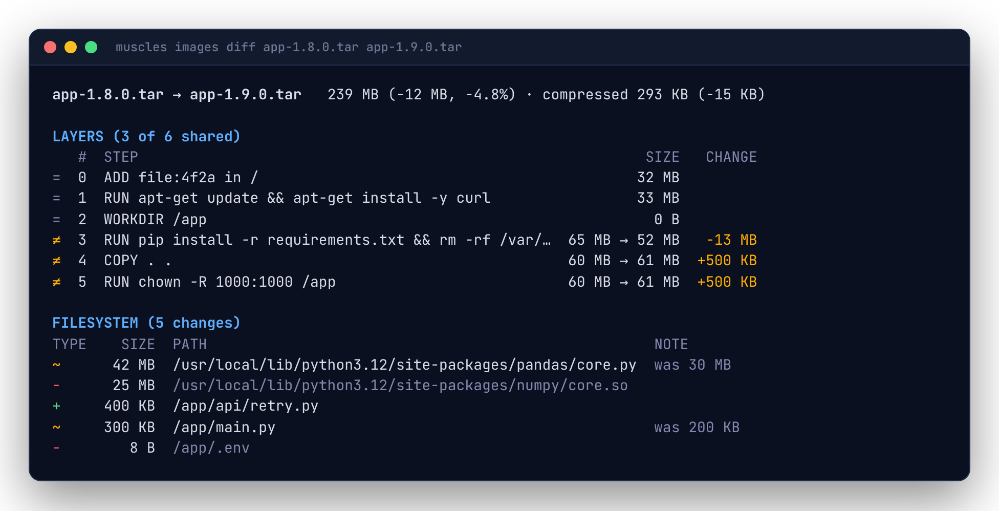

# Comparing images

`muscles images diff BASE TARGET` shows what changed from one image to another: a release to the next, the main branch to a pull request, or two ways of building the same thing.

```sh
muscles images diff ghcr.io/acme/app:1.8.0 ghcr.io/acme/app:1.9.0
```



## The summary

The first line says what happened in one sentence:

```text
app:2 is 42 MB bigger than app:1 (+10.5%), mostly in RUN pip install -r requirements.txt (+40 MB). Biggest changes: + /usr/local/lib/python3.12/site-packages/torch/ (38 MB), ~ /app/main.py (+2 KB). Packages: installed torch 2.4.1 (pip); upgraded libssl3 3.0.14-1 → 3.0.15-1.
```

The next line is the target's uncompressed size and its change from the base, then the compressed size (what clients pull) and its change. `--json` has the sentence as `summary`.

## Layers

Layers are lined up by position. From the bottom up, layers with the same digest are **shared** (`=`): a client that has the base already has them and won't pull them again. The first layer that differs, and every layer above it, is marked `≠` with its size in both images.

Few shared layers usually means an early step changed: a new base image, or a `COPY` of the whole source tree before installing dependencies. Order Dockerfile steps from least to most often changed to keep more layers shared.

## Packages

When the images' package databases differ (dpkg, apk, rpm or pip), a table lists the packages installed (`+`), upgraded (`~`, old → new version) and removed (`-`). This is often the quickest answer to "why did it grow": a new dependency, or an upgrade that pulled others in.

## Filesystem

The second table compares the two final filesystems, the way a container sees them:

| Marker | Meaning |
|---|---|
| `+` | The path is new in the target. |
| `~` | The path's contents, link target or type changed. The note shows the old size. |
| `◌` | Same contents, new permissions or owner. |
| `-` | The path is gone from the target. |

Directories only appear when they were added or removed with nothing inside. Rows roll up by directory like [`changes list`](layers.md#looking-inside-a-layer); `--files` lists every file.

## In a pull request

Write the diff to the GitHub Actions job summary, so reviewers see what a change does to the image:

```sh
muscles images diff ghcr.io/acme/app:main app.tar -o markdown >> "$GITHUB_STEP_SUMMARY"
```

Long file lists are folded into a `<details>` block. See [CI](ci.md) for a complete workflow.
