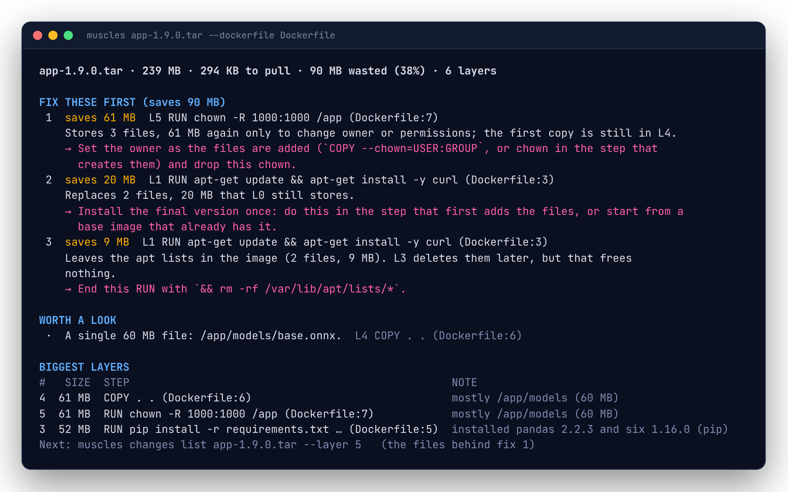

# Getting started

muscles is one static binary. It needs no config file, no daemon and no Docker: point it at an image and it explains it.

## Install

With Homebrew, on macOS or Linux:

```sh
brew install rossedman/tap/muscles
```

With Go 1.26 or later:

```sh
go install github.com/rossedman/muscles/cmd/muscles@latest
```

Or download an archive for your platform from the [releases page](https://github.com/rossedman/muscles/releases) and put `muscles` on your `PATH`. Archives include shell completions and a man page.

In CI, use the container image: `ghcr.io/rossedman/muscles`.

## Your first image

Pick any image. A public one works without logging in:

```sh
muscles python:3.12-slim
```



That's the short way to run `muscles images inspect`: the image's size, what it costs to pull, how much of it is waste, and the fixes that save the most, each with the layer to change and what to change. If it's your own image, add `--dockerfile Dockerfile` and each fix names its line.

At a terminal, each command ends with a `Next:` line on stderr suggesting what to run next. Follow it and you'll walk from the summary down to the files.

## Every layer

```sh
muscles layers python:3.12-slim       # short for: muscles layers list python:3.12-slim
```


Each row is a layer, bottom to top:

| Column | Meaning |
|---|---|
| `#` | The layer's index. Commands like `changes list --layer N` use it. |
| `SIZE` | Uncompressed bytes the layer stores. |
| `+ ~ ◌ -` | Files added, modified, rewritten with the same contents, and deleted. |
| `STEP` | The Dockerfile instruction that made the layer. Dimmed rows are steps that made no layer (`ENV`, `CMD`, ...). |
| `NOTE` | The packages the layer installed, or where most of the bytes went, or a ⚠ warning worth acting on. |

The last line totals the image: uncompressed size, compressed size (what you pull) and waste.

[Reading layers](layers.md) explains every column and note.

## Look inside a layer

```sh
muscles changes list python:3.12-slim --layer 2
```


Directories whose changes are all alike are rolled up into one row. Add `--files` to see every file, `--path /usr/local` to narrow it down, or `--type deleted` to see only deletions.

## Find the waste

```sh
muscles waste list python:3.12-slim
```

Waste is bytes stored in a layer that the final image doesn't show, because a later layer overwrote, deleted or re-stored them. `muscles IMAGE` turns it into fixes; [Finding waste](waste.md) explains each kind.

## Compare two images

```sh
muscles images diff ghcr.io/acme/app:1.8.0 ghcr.io/acme/app:1.9.0
```

The first line is the answer in one sentence: how much it grew or shrank, in which step, the biggest file changes and the packages that changed. See [Comparing images](diff.md).

## Where images come from

muscles reads the same image from wherever it is:

| You pass | muscles reads |
|---|---|
| `app:dev` | the local Docker (or Podman) daemon, if it has the image; otherwise the registry |
| `ghcr.io/acme/app:main` | the registry, streaming layers without pulling them |
| `app.tar` | a `docker save` tarball, or `buildx --output type=docker,dest=app.tar` |
| `./out` or `oci://./out:tag` | an OCI layout directory, or `buildx --output type=oci` |

Force one with a prefix (`docker://`, `registry://`, `tar://`, `oci://`) or `--source`. For multi-platform images, muscles picks Linux on your machine's architecture; choose another with `--platform linux/arm64`.

Registry credentials come from your Docker config and credential helpers, the same ones `docker pull` uses. If a registry says no, `docker login` to it.

## Scripts and machines

Every command takes `--json`, and plain output (the default when stdout isn't a terminal) is one tab-separated record per line:

```sh
muscles layers list app:dev --json | jq '.image.waste'
muscles changes list app:dev --files -o plain | sort -t$'\t' -k3 -n | tail
```

See [Output formats](output.md).

## Next

- Put budgets in CI: [CI](ci.md) and [Checks and budgets](checks.md).
- Every command and flag: [CLI reference](cli.md), or `muscles help <command>`.
