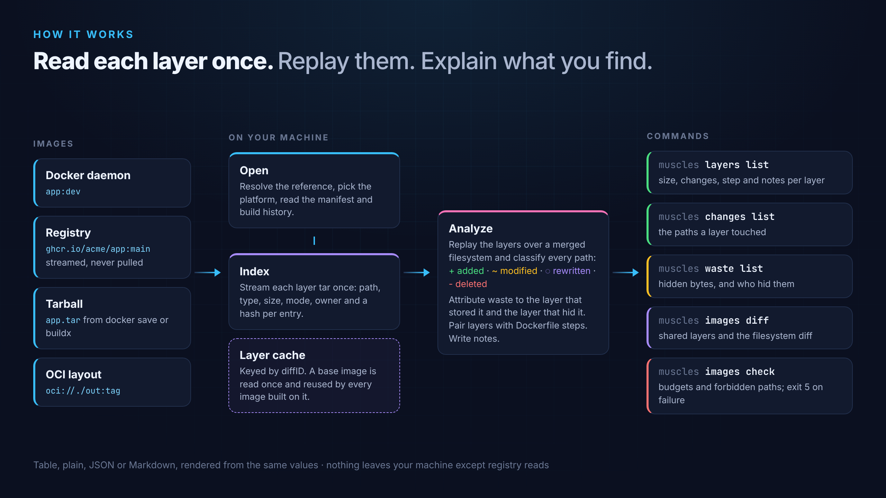

# How it works

## 1. Open

muscles resolves the reference to one image, using [go-containerregistry](https://github.com/google/go-containerregistry):

- A path that exists is a tarball (a file) or an OCI layout (a directory).
- Otherwise, the local Docker daemon is asked first; if it doesn't have the image (or isn't running), the registry is.
- For a multi-platform image, it picks the manifest for `--platform`, or Linux on your machine's architecture. Attestation manifests are skipped.

It reads the manifest (layer digests and compressed sizes) and the config (the build history).

## 2. Index

Each layer is a tar stream. muscles reads every layer **once**, decompressing as it streams, and records one entry per tar header: the path, type, size, permissions, owner, link target, and an xxhash of the contents for regular files. Contents are never kept.

Whiteouts are recorded as they're defined by the OCI image spec: `.wh.NAME` deletes `NAME` from lower layers, and `.wh..wh..opq` hides everything below its directory in lower layers.

Layer indexes are cached by diffID (the digest of the uncompressed layer) in `$XDG_CACHE_HOME/muscles/layers/`, zstd-compressed and written atomically. Because a diffID names the content, a cached index never goes stale: a base image is indexed once and reused by every image built on it.

## 3. Analyze

muscles replays the layers, bottom to top, over a merged filesystem tree. For each entry:

| The path below | The entry | Result |
|---|---|---|
| doesn't exist | anything | **added** |
| exists, different contents, link or type | a file, link or directory | **modified**; the old bytes become waste |
| exists, same contents | a file | **meta**; the old bytes become waste |
| exists | a whiteout | **deleted**; everything removed becomes waste |
| a directory | a directory | nothing (tar files repeat parent directories) |

An opaque whiteout removes everything the lower layers have below its directory, but keeps what its own layer adds there.

Each wasted byte is attributed to two layers: the one that **stored** it and the one that **hid** it.

Layers are paired with history entries that made a layer, aligned at the top (some builders drop the base image's history), and history entries without a layer are kept as the empty steps between layers.

Finally, each layer gets:

- **Mostly**: where its bytes went. Starting at `/`, muscles descends while one directory holds at least 80% of the layer's bytes. If no directory dominates, it names the top three.
- **Notes**: package caches, deletions that free nothing, permission-only rewrites and large files.

The analysis package does no I/O, so every command, and both the human and machine output, are built from the same values.

## Performance

Indexing is bound by decompression and hashing, and reads each layer once. Re-opening an image whose layers are cached takes well under a second, plus the registry round trips for its manifest and config.
