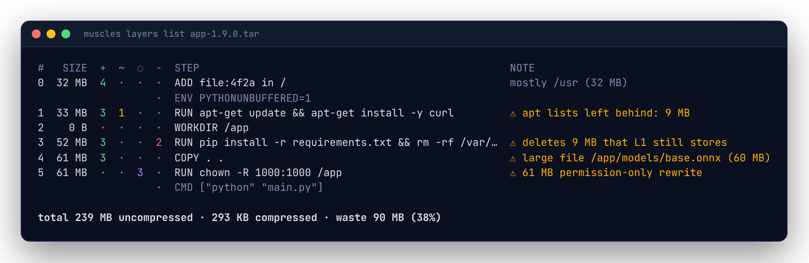
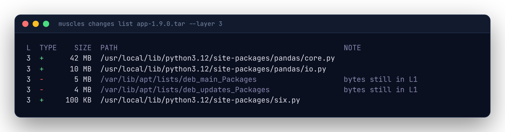

# Reading layers

`muscles layers list IMAGE` is the overview: one row per layer, bottom (the base image) to top. `muscles changes list IMAGE` is the detail: the paths each layer touched.



## Layers and steps

A Dockerfile instruction that changes the filesystem (`RUN`, `COPY`, `ADD`, `FROM`'s base layers) makes a layer. Instructions that only change metadata (`ENV`, `LABEL`, `WORKDIR` without new files, `CMD`, `ENTRYPOINT`, `USER`, `EXPOSE`) don't; muscles shows them dimmed between layers so the whole Dockerfile reads in order.

The STEP column comes from the image config's build history. muscles cleans it up so it reads like the Dockerfile line: `/bin/sh -c #(nop)  ENV A=1` becomes `ENV A=1`, and BuildKit's `RUN |2 A=1 B=2 /bin/sh -c make # buildkit` becomes `RUN make`. A base image's own steps show as written by its builder (for example `# debian.sh ...`).

Some builders don't record history. Then STEP shows `?`, and everything else still works.

## The four kinds of change

Each tar entry in a layer is compared with the filesystem built from all the layers below it:

| Marker | Type | Meaning |
|---|---|---|
| `+` | added | The path didn't exist below. |
| `~` | modified | The path existed below with different contents, link target or type. The old copy is still stored in its layer. |
| `◌` | meta | The same contents stored again; only permissions, owner or timestamps changed. The whole file is stored twice. |
| `-` | deleted | A whiteout removed the path (or an opaque whiteout removed everything below a directory). The size is what disappeared from the filesystem; the bytes are still in the layer that stored them. |

Counts in `layers list` are files, symlinks and other non-directory entries. A directory that's declared again in a later layer (tar files repeat parent directories) is not a change.

## Notes

The NOTE column shows where most of a layer's bytes went (`mostly /usr/local/lib/python3.12/site-packages (151 MB)`), or a warning:

| Note | What it means | Usual fix |
|---|---|---|
| `apt lists left behind: 12 MB` | A package manager cache is in the layer. muscles knows apt, apk, yum, dnf, pip, npm, yarn and the Go build cache. | Clean it in the same `RUN`: `apt-get install ... && rm -rf /var/lib/apt/lists/*`, `pip install --no-cache-dir`, or a cache mount. |
| `deletes 12 MB that L1 still stores` | A deletion that frees nothing: the bytes are in an earlier layer. | Delete in the layer that created the files. |
| `96 MB permission-only rewrite` | Files stored again just to change owner or mode. | `COPY --chown=app:app`, `COPY --chmod`, or set ownership in the layer that creates the files. |
| `large file /app/model.bin (210 MB)` | A single file at least `warn.large_file` (50 MB). | Worth a look; maybe it belongs in a volume or a separate image. |

When a layer has several warnings, the table shows the first and `(+N more)`; `--json` has them all. Thresholds are settings: see [Configuration](configuration.md).

## Looking inside a layer

```sh
muscles changes list app:dev --layer 3
```



Rows are sorted by size, largest first. To keep the list readable, muscles rolls up a directory into one row when everything below it changed the same way (same type, same previous layer), opening the biggest directories first until the list fits about `--limit` rows (30). A rolled-up row ends in `/` and its note says how many files it holds.

| Flag | Effect |
|---|---|
| `--layer N` | Only layer N. Without it, every layer, with the layer in the first column. |
| `--type added,deleted` | Only these change types. |
| `--path /usr/local` | Only paths at or below this one. |
| `--min-size 1MB` | Only rows at least this big. |
| `--files` | Every file; no rolling up. |
| `--limit N` | About how many rows to roll up into, per layer. |

The NOTE column says what a change replaced (`was 6 MB (L1)`), that a rewrite has the same contents as an earlier layer (`same contents as L4`), or that a deletion's bytes are still stored (`bytes still in L1`).
