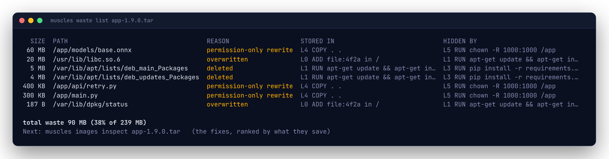

# Finding waste

Layers only ever add bytes. When a later layer overwrites, deletes or re-stores a file, the earlier copy stays in its layer: you pull it, store it and scan it, but no container ever sees it. That's waste.

## Fix it

Start with the fixes, biggest saving first:

```sh
muscles app:dev --dockerfile Dockerfile     # the same as: muscles images inspect app:dev
```


```text
app:dev · 401 MB · 138 MB to pull · 108 MB wasted (27%) · 6 layers

FIX THESE FIRST (saves 108 MB)
 1  saves 60 MB  L5 RUN chown -R app:app /app (Dockerfile:14)
    Stores 1,204 files, 60 MB again only to change owner or permissions; the first copy is still in L4.
    → Set the owner as the files are added (`COPY --chown=USER:GROUP`, or chown in the step that creates them) and drop this chown.
 2  saves 36 MB  L1 RUN apt-get update && apt-get install -y curl git (Dockerfile:5)
    Leaves the apt lists in the image (41 files, 36 MB). L3 deletes them later, but that frees nothing.
    → End this RUN with `&& rm -rf /var/lib/apt/lists/*`.
```

Each fix names the layer, its step and (with `--dockerfile`) its line, what's wrong and what to change. Every wasted byte is counted by exactly one fix, so the savings add up to the image's waste; `--limit` caps how many are shown. Below the fixes are files worth a look (very large single files) and the three biggest layers.

## Every wasted byte

```sh
muscles waste list app:dev
```



Each row names the bytes, why they're hidden, the layer that **stored** them and the layer that **hid** them. Rows roll up by directory the same way as [`changes list`](layers.md#looking-inside-a-layer); `--files` lists every file.

The total at the bottom is also in `layers list` and in `--json` output as `image.waste`.

## The three kinds, and their fixes

### Overwritten

A later layer stored new contents at the same path. Common with config files, package databases (`/var/lib/dpkg/status`) and libraries upgraded after the base image.

Small amounts are normal. Large ones usually mean the same thing is installed twice: once in the base image and again on top. Use a base image closer to what you need, or install in one step.

### Deleted

A later layer deleted the path. The bytes are still in the layer that created them.

```dockerfile
# Wasteful: the lists are in the first layer forever.
RUN apt-get update && apt-get install -y curl
RUN rm -rf /var/lib/apt/lists/*

# Better: create and delete in the same layer.
RUN apt-get update && apt-get install -y curl \
 && rm -rf /var/lib/apt/lists/*
```

Multi-stage builds go further: build in one stage and `COPY --from` only what you need.

### Permission-only rewrite

A later layer stored the same contents again to change owner or mode. `chown -R` and `chmod -R` over a big directory double its size.

```dockerfile
# Wasteful: /app is stored twice.
COPY . /app
RUN chown -R app:app /app

# Better: set ownership as you copy.
COPY --chown=app:app . /app
```

## Waste in CI

Fail a build when waste grows past a budget, in bytes or as a share of the image:

```yaml
# .muscles.yaml
check:
  max_waste: 50MB   # or "10%"
```

See [Checks and budgets](checks.md).
